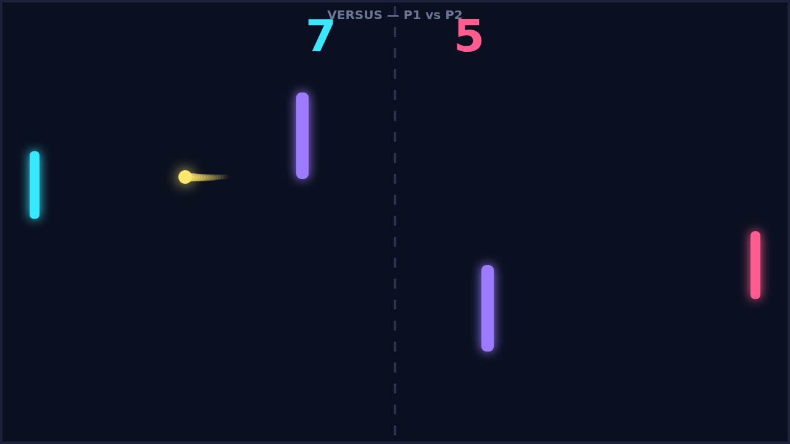
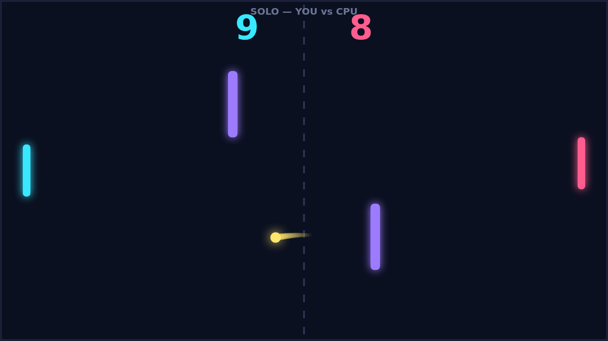

# Carom

Carom is a top-down paddle duel played on a single dark field. Two paddles face
each other across a dashed net, a bright ball streaks between them, and a pair of
blocks stand in the open court to turn every exchange into a bank shot waiting to
happen. A rally opens with a quiet serve and then accelerates: each paddle you
catch the ball with sends it back a little faster, until the court is a blur of
neon and nerve.

The twist that gives Carom its name is spin. Sweep your paddle as the ball
arrives and you bend its flight — a paddle moving down curls the ball one way, a
paddle moving up curls it the other. A ball carrying spin does not travel in a
straight line; it arcs across the court, so the shot that looks safe to your
opponent hooks past their paddle at the last moment. Learn to read the curve and
you can thread the ball through the gap beside an obstacle; misread it and you
hand over the point.

The obstacles make the middle of the field dangerous for both players. A flat
shot that clips a block caroms off at a fresh angle, and a spinning shot that
banks off one can come back at you from a direction nobody planned. Good players
use them on purpose — aiming for the block so the rebound lands where the
opponent is not — and great rallies are the ones where the ball visits every
bank on the table before anyone scores.

Play solo against a CPU that tracks the ball and defends its edge, or hand the
second paddle to a friend for a versus match on the same keyboard. A game runs to
eleven, win by two, so an even match tips into sudden swings at deuce where one
well-curved serve decides everything. Points come fast, the trail behind the
ball shows you exactly how your last shot curved, and the next serve is only a
breath away.
